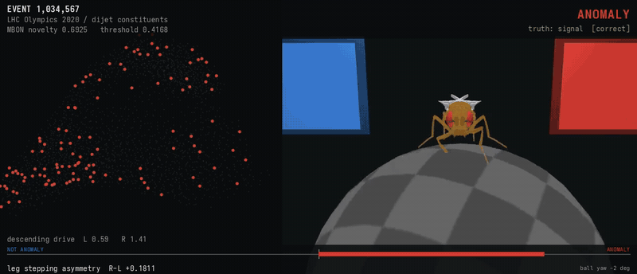
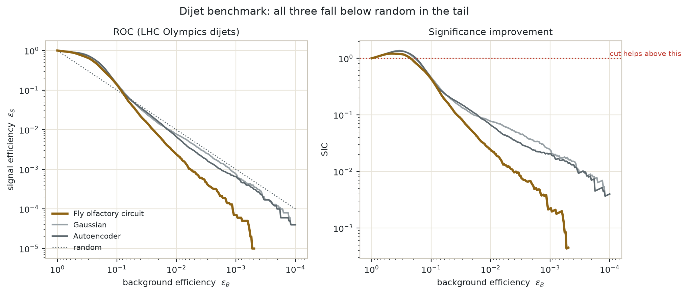
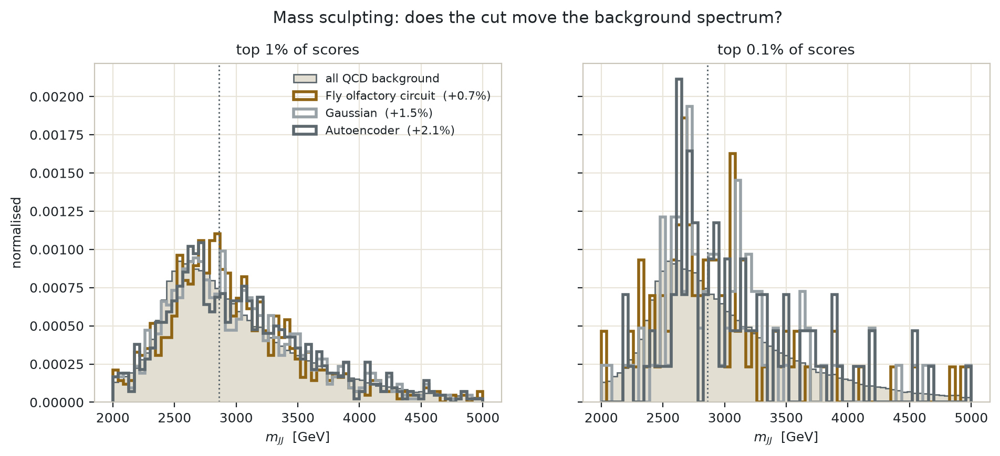
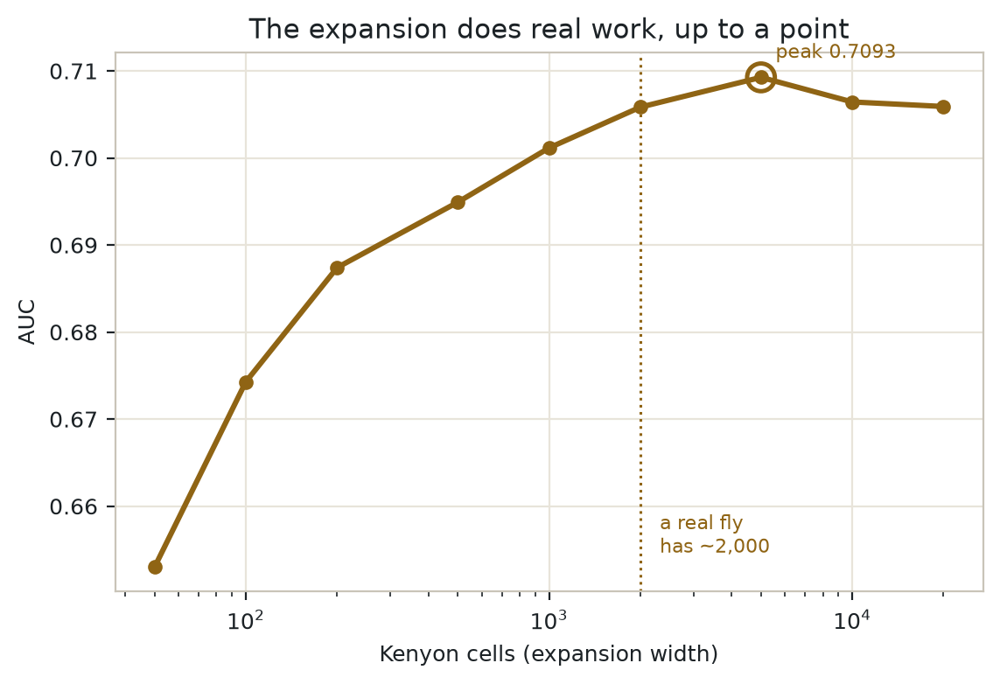
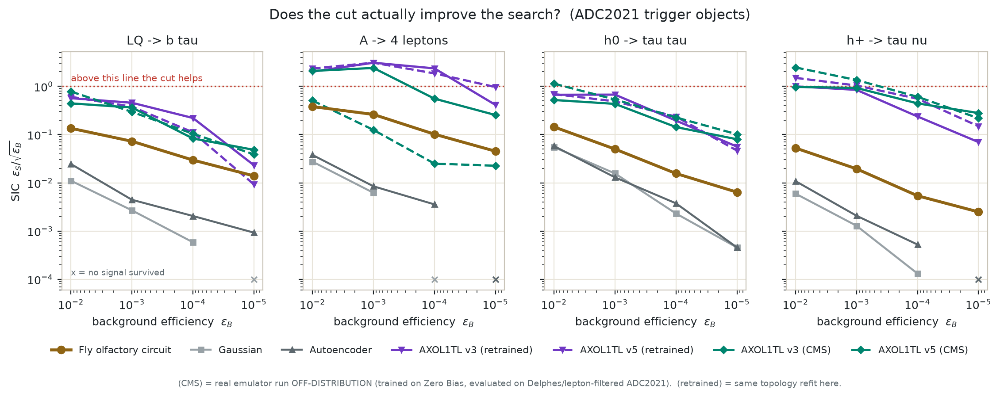
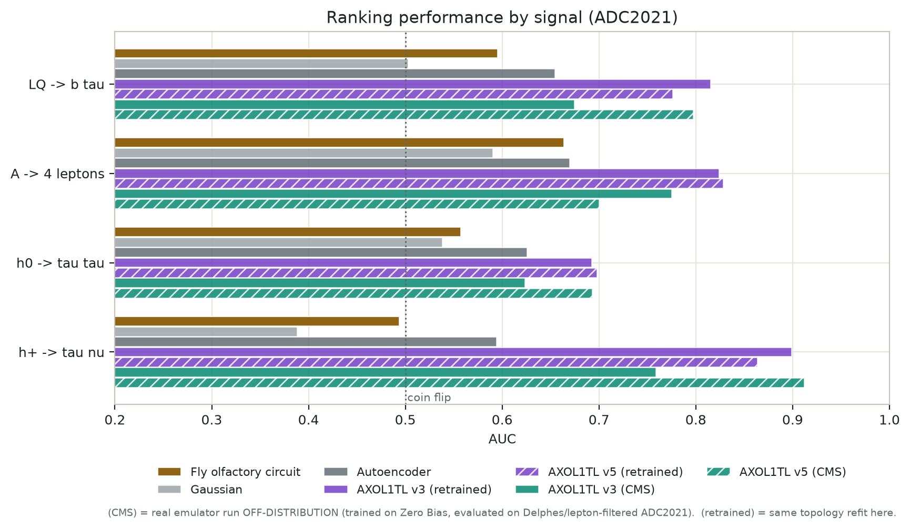
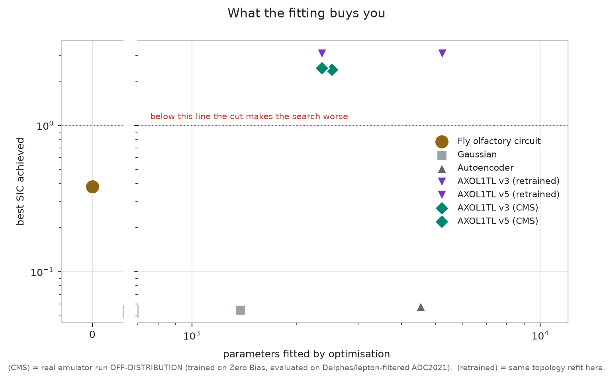

# flyad

**A fruit fly's olfactory circuit as an LHC anomaly detector.**

Zero fitted parameters, no gradients, and a verdict delivered by a
morphologically accurate fly turning on a spherical treadmill. Benchmarked on
LHC Olympics 2020 dijets and on ADC2021 trigger objects against
[AXOL1TL](https://github.com/cms-hls4ml/AXOL1TL), the anomaly trigger actually
running in the CMS Global Trigger.

**It loses.** Max SIC 1.21, below 1.0 at every realistic trigger working point,
beaten by a plain autoencoder. That is the honest headline and the rest of this
README does not walk it back. What it does do, it does with nothing fitted.



| | |
| --- | --- |
| `outputs/lhco/reel_combined.mp4` | real Kenyon cells firing beside the fly deciding |
| `outputs/lhco/reel_tethered.mp4` | dijet events, fly on the treadmill |
| `outputs/adc2021/reel_tethered.mp4` | trigger objects, same preparation |
| `outputs/lhco/brain_activity.mp4` | 2,417 measured Kenyon cells, 5% firing per event |

### What is actually measured, and what is a model

| Component | Provenance |
| --- | --- |
| Fly **body** | real -- NeuroMechFly, from a micro-CT scan |
| **AXOL1TL** weights | real -- CMS's own, via their bit-exact emulator |
| PN -> KC **connectivity** | real when using `flyad.connectome`; sampled otherwise (they perform the same -- see below) |
| Kenyon cell **positions** | real -- FlyWire v783 soma coordinates |
| Circuit **dynamics** | a model, from published descriptions |
| CPG **gait** | a model, from flygym |

### Three findings worth the reading time

1. **Fitted one-class baselines go *below random* in the tail.** At
   eps_B = 1e-3 the Gaussian and autoencoder keep ~5x *less* signal than chance
   would; the fly keeps ~8x more. AUC hides this completely.
2. **The readout quantises to 1 bit for free** (-0.0002 AUC), which collapses
   the mushroom body to a literal Bloom filter -- the data structure Dasgupta
   et al. named in 2018.
3. **The measured connectome performs identically to a degree-matched random
   matrix** (0.6893 vs 0.6947 +/- 0.0026), which is what Caron et al. (2013)
   predict and a useful negative control on the whole exercise.

---

## Why a fly

The fly mushroom body is a novelty detector. This is not an analogy.

- Dasgupta, Stevens & Navlakha, *A neural algorithm for a fundamental computing
  problem*, **Science** 358:793 (2017) — the antennal lobe → Kenyon cell
  projection is a locality-sensitive hash ("FlyHash").
- Dasgupta, Sheehan, Stevens & Navlakha, *A neural data structure for novelty
  detection*, **PNAS** 115:13093 (2018) — the mushroom body implements a
  variant of a Bloom filter, reporting whether an odour is novel or familiar.

An anomaly search at a hadron collider is the same problem: see a great deal of
background, then flag the thing that is not like it.

## How it differs from an autoencoder (and how it doesn't)

It is fair to say the fly expands where an autoencoder compresses. It is *not*
fair to call the architecture alien: a random frozen projection plus a top-k
activation plus a linear readout is, in ML terms, close to an Extreme Learning
Machine, and almost exactly a **top-k sparse autoencoder** -- the architecture
currently used for LLM interpretability. The genuinely unusual part is the
*learning rule*, not the topology: no backpropagation, and plasticity gated by a
third factor (dopamine) that has no standard deep-learning analogue.

| Conventional LHC anomaly detector | This |
| --- | --- |
| bottleneck, compress 50 → 8 | **expands** 50 → 2000 |
| encoder weights fitted by SGD | **sparse binary random**, never trained |
| reconstruction error | mean surviving MBON synaptic weight |
| epochs of gradient descent on a GPU | one pass, CPU, no gradients |
| ~10⁴–10⁶ trainable parameters | **0** |

## Pipeline

```
event (700 hadrons, pT/eta/phi)
  │
  ├─ anti-kT R=1.0 (FastJet) → two leading jets
  │
  ├─ ANTENNAL LOBE
  │    25-cell polar grid per jet (5 radial rings × 5 sectors),
  │    pT-weighted, rotated into each jet's principal axis
  │    → 50 glomeruli
  │    divisive normalisation (Olsen-Bhandawat-Wilson 2010)
  │
  ├─ FLYHASH
  │    sparse binary random projection, 50 → 2000 Kenyon cells,
  │    6 projection neurons sampled per KC
  │    APL feedback inhibition → top 5% winner-take-all
  │    → 100-of-2000 binary tag
  │
  ├─ MUSHROOM BODY
  │    MBON synapses depressed by every background event seen
  │    novelty = mean surviving weight over the tag's active KCs
  │
  └─ DESCENDING DRIVE
       novelty vs threshold → target button
       NeuroMechFly v1 (MuJoCo) CPG tripod gait walks there
```

### The one thing worth pointing out

The antennal lobe applies **divisive normalisation**, which in the fly makes the
odour representation invariant to concentration. Transposed to jets, that is
exactly pT-scale invariance.

This matters. An unnormalised anomaly detector on dijets mostly learns that
"high pT is unusual" and rediscovers the trigger threshold. The fly refuses to
do this, for reasons that have nothing to do with particle physics.

### What is *not* biology

The steering is a proportional controller on heading error. The real
MBON → DAN → descending neuron pathway biases turning, but it is not a P
controller, and pretending otherwise would be the one dishonest claim in the
repository.

## Install

Requires Python 3.12. The core package has no exotic dependencies; the embodied
fly is optional because flygym pins `<3.13` and is only needed for the videos.

```bash
uv venv --python 3.12
uv pip install -e .            # circuit + both analyses
uv pip install -e ".[body]"    # + flygym/NeuroMechFly, for the reels
uv pip install -e ".[dev]"     # + pytest
uv pip install "pyopengl==3.1.7"   # 3.1.10 ships broken on PyPI
```

```python
from flyad import FlyAnomalyDetector

det = FlyAnomalyDetector(n_inputs=50)   # 50 glomeruli, 2000 Kenyon cells
det.experience(background)              # the entire training procedure
scores = det.score(events)              # MBON novelty, higher = more anomalous
det.n_trainable_parameters              # 0
```

Rendering the fly needs EGL and a GPU driver providing `libEGL`:

```bash
export MUJOCO_GL=egl
```

## Data

LHC Olympics 2020 R&D dataset, 1M QCD dijet background + 100k
Z′(3.5 TeV) → X(500 GeV) Y(100 GeV) signal, from
[Zenodo record 6466204](https://zenodo.org/records/6466204):

```bash
curl -L -o data/events_anomalydetection_v2.h5 \
  "https://zenodo.org/api/records/6466204/files/events_anomalydetection_v2.h5/content"
```

Truth labels are used **only** for evaluation. Training is one-class on
background.


## Results

### LHC Olympics 2020 (dijets)







### ADC2021 (trigger objects, against the real AXOL1TL)








LHCO R&D, trained one-class on 600,000 QCD background events, evaluated on a
held-out 100,000 QCD + 100,000 Z' signal. All three detectors see the same 50
glomeruli. Labels are used only for evaluation.

| Detector | Trainable params | Train | AUC | Max SIC | eps_S @ eps_B=1e-2 |
| --- | ---: | ---: | ---: | ---: | ---: |
| Fly olfactory circuit | 0 | 19.1s | 0.7075 | 1.21 | 0.002 |
| Gaussian (Mahalanobis) | 1,325 | 0.1s | 0.7372 | 1.37 | 0.008 |
| Autoencoder | 4,568 | 16.0s | 0.7407 | 1.35 | 0.007 |

**The fly loses.** It is also the only one of the three with nothing to fit, and it
trains in 19 seconds on a CPU in a single pass with no gradients.

### Where all three fail

A discovery lives in the tail, not at loose cuts. Signal efficiency at fixed
background efficiency, against the line random guessing gives you (**bold** = worse
than random):

| eps_B | random | fly | Gaussian | autoencoder |
| ---: | ---: | ---: | ---: | ---: |
| 0.5 | 0.5 | 0.8535 | 0.8908 | 0.8937 |
| 0.2 | 0.2 | 0.4046 | 0.4716 | 0.4931 |
| 0.1 | 0.1 | 0.1371 | 0.1457 | 0.1403 |
| 0.05 | 0.05 | **0.0337** | **0.0457** | **0.0468** |
| 0.01 | 0.01 | **0.0024** | **0.0078** | **0.0066** |
| 0.001 | 0.001 | **0.0001** | **0.0008** | **0.0007** |

Every detector beats chance at loose cuts and drops **below** it once you cut hard,
crossing over between eps_B = 0.10 and 0.05. The most anomalous-looking events under
all three methods are not the Z' -- they are unusual QCD. That is why max SIC sits
near 1.2-1.4 for all of them: almost no significance improvement, whatever you fit.

This is not a defect of the fly. It is the known failure mode of unsupervised
anomaly detection at a hadron collider, and the fly reproduces it faithfully at a
fraction of the parameter count.

### Does the expansion help?

Sweeping the Kenyon cell count with everything else held fixed (subsampled to
200k train / 100k test):

| Kenyon cells | AUC |
| ---: | ---: |
| 50 | 0.6530 |
| 100 | 0.6743 |
| 200 | 0.6874 |
| 500 | 0.6949 |
| 1,000 | 0.7012 |
| 2,000 | 0.7058 |  <- a real fly
| 5,000 | 0.7093 |
| 10,000 | 0.7064 |
| 20,000 | 0.7059 |

Going from 50 cells to 5,000 is worth 0.0563 AUC, so the expansion is
carrying real weight rather than decorating a random projection. Past the peak it
decays -- the hash becomes fine enough that similar events stop sharing Kenyon
cells and the novelty estimate goes noisy.

The optimum is 5,000. A real fly has about 2,000, which scores 0.7058 against the
peak's 0.7093. Draw your own conclusions.


## The real AXOL1TL

`AXOL1TL` (Anomaly eXtraction Online Level-1 Trigger aLgorithm) is CMS's anomaly
detection trigger, running in the Global Trigger FPGAs at 40 MHz within a 50 ns
latency budget. This repository does not reimplement it -- it compiles the
collaboration's own bit-exact hls4ml emulator and calls it through a small
ctypes shim, so the score is the quantity the trigger computes in firmware.

```bash
mkdir -p external && cd external
git clone --depth 1 https://github.com/cms-hls4ml/AXOL1TL.git
git clone --depth 1 https://github.com/cms-hls4ml/hls4mlEmulatorExtras.git
git clone --depth 1 https://github.com/Xilinx/HLS_arbitrary_Precision_Types.git hls

EX=$(realpath hls4mlEmulatorExtras); HLS=$(realpath hls)
(cd hls4mlEmulatorExtras && make install)
(cd AXOL1TL && make \
   INCLUDES="-I$EX/include/hls4ml -I$EX/include/ap_types -I$HLS/include" \
   LD_FLAGS="-L$EX/lib64 -lemulator_interface -Wl,-rpath,$EX/lib64" \
   CXXFLAGS="-O3 -fPIC -std=c++17")
(cd shim && g++ -O3 -fPIC -std=c++17 \
   -I$EX/include/hls4ml -I$EX/include/ap_types -I$HLS/include \
   -shared axo_shim.cpp -L$EX/lib64 -lemulator_interface -ldl \
   -Wl,-rpath,$EX/lib64 -o libaxoshim.so)
```

The build is verified by a golden test: `cms-hls4ml/test_AXOL1TL` prints
`2542.75` for a particular 57-value input, and `tests/test_flyad.py` asserts we
reproduce it exactly. That pins the vendored HLS types, the emulator build, the
shim, and the per-version `read_result` type variant all at once.

### Architectures, read from the emulator source

| Version | Topology | Score | Weights |
| --- | --- | --- | ---: |
| v3 | 57 -> 32 -> 16 -> 8 | sum of squared latent means | 2,520 |
| v5 | 57 -> 29 -> 10 -> 9 -> 6 -> 4 -> 6 -> 9 -> 10 | squared distance in feature space | 2,362 |

v5 is the interesting one: the decoder reconstructs the 10-dimensional post-ReLU
activation rather than the 57 inputs, so the error is computed 10-wide instead
of 57-wide. That is a hardware decision, and not one you would guess.

### Two caveats, stated up front

AXOL1TL was trained on real CMS Zero Bias data in raw L1 hardware units. ADC2021
is Delphes-simulated and lepton-filtered. Running the pretrained emulator on
ADC2021 is therefore **off-distribution**, and a weak result there is not
evidence about its performance in CMS. `flyad/axol1tl_retrain.py` closes that
gap by fitting the same topologies, with the same input scaling and the same
scoring rule, to the ADC2021 background -- though in float32, where CMS used
4-bit quantisation-aware training, so it isolates the training distribution and
not the quantisation.

## Three ways to let the circuit move the fly

Nothing in any of these is keyframed. The difference is how much of the movement
the mushroom body actually computes.

| Runner | What computes the motion | Verdict |
| --- | --- | --- |
| `ButtonPressRunner` | P controller on heading error; the MBON supplies one bit (which target) | works, but it is navigation wearing a fly costume |
| `FreeWalkRunner` | `descending_drive` alone, open loop, position emergent | most faithful, least reliable |
| `TetheredRunner` | same `descending_drive`, on a spherical treadmill | used for the reel |

A real fly does not navigate to a goal. Odour valence biases its *turn rate* and
position is a consequence -- klinokinesis. `FreeWalkRunner` does exactly that:
the drive is set once from the novelty score and held, and nothing ever reads
the fly's position back.

### What free walking actually showed

Drift direction agreed with the MBON in **4 of 6** trials (2.5 s, three seeds x
novel/familiar). Both disagreements came from one seed where the fly fell --
forward speed collapsed to 0.6 mm/s against 6.8-10 mm/s for a gait that holds.
At 5 s a trial crashed the physics solver.

A second embodiment result fell out of it. The turn command that reads perfectly
on the treadmill (`max_turn=0.55`) **trips an untethered fly**: free walking
drops below 2 mm/s and the drift sign inverts. The tethered rig hides a failure
mode that only appears once the animal has to hold itself up, which is a large
part of why labs run both preparations.

### The treadmill readout is a display, not a decision

Two biases were measured in the tethered rig and are recorded as constants in
`flyad/embodied_tethered.py`:

- **Intrinsic drift.** With a perfectly symmetric drive the ball still turns
  +248 +/- 167 deg in 1.2 s, leftward in 6 of 6 seeds. flygym mounts the
  treadmill fractionally off-axis. Real experiments subtract each animal's
  baseline turning for this reason, and so do we.
- **Turn asymmetry.** Against that baseline, a full left command moves the ball
  +29 deg while a full right command moves it -1205 deg -- roughly 40x.

The second is too large to correct away, so the mushroom body output neuron
makes the call and the ball is shown as the behavioural readout it is. Reading a
verdict off an instrument that biased would be as dishonest as keyframing the
legs, only harder to notice.

## On "zero parameters"

The fly fits nothing: no objective is minimised, no search is run, and the
50 -> 2000 projection is drawn from a seed and frozen. But it is not empty. It
holds 2,000 activation counts, one per Kenyon cell, which obviously depend on
the data.

| Detector | Fitted by optimisation | Data-dependent state |
| --- | ---: | ---: |
| Fly olfactory circuit | 0 | 2,000 counts |
| Autoencoder | 4,534 | -- |
| AXOL1TL v5 | 2,362 | -- |

The fly is nonparametric in the sense a histogram or a Bloom filter is: it has
capacity, but that capacity is tallied rather than fitted. Quoting only the zero
would be a half-truth, so both numbers are reported.

## Layout

The two studies share the circuit and nothing else.

```
flyad/
  antennal_lobe.py     divisive normalisation -- the only dataset-agnostic step
  flyhash.py           sparse binary random projection + winner-take-all
  mushroom_body.py     MBON novelty, the Bloom filter
  detector.py          assembled one-class detector
  descending.py        MBON output -> locomotor drive (shared by both bodies)
  baselines.py         Gaussian and autoencoder comparisons
  plotting.py          shared figure palette and styling
  embodied.py          free walking and walk-to-target arenas
  embodied_tethered.py spherical treadmill / in-air preparations

  lhco/                LHC Olympics 2020 -- offline, resonant, dijets
    lobe.py            dijet constituents -> 50 glomeruli
    data.py            LHCO loading, anti-kT clustering

  adc2021/             ADC2021 / AXOL1TL -- online, L1 trigger objects
    lobe.py            19 trigger objects -> 51 glomeruli
    axol1tl.py         the real CMS emulator, via ctypes
    axol1tl_retrain.py the same topologies, fitted to this background

scripts/
  lhco/      encode.py  run_analysis.py  render_reel.py  build_report.py  make_plots.py
  adc2021/   run_trigger.py  render_tethered_reel.py  make_plots.py

tests/       test_circuit.py  test_lhco.py  test_adc2021.py  test_embodiment.py
data/        lhco/  adc2021/
outputs/     lhco/  adc2021/        (each with its own figures/)
external/    AXOL1TL  hls4mlEmulatorExtras  hls  shim
```

### Running each study

```bash
# LHC Olympics dijets
python scripts/lhco/encode.py
python scripts/lhco/run_analysis.py
python scripts/lhco/make_plots.py
MUJOCO_GL=egl python scripts/lhco/render_reel.py

# ADC2021 trigger objects, against the real AXOL1TL
python scripts/adc2021/run_trigger.py --save-scores outputs/adc2021/trigger_scores.npz
python scripts/adc2021/make_plots.py
MUJOCO_GL=egl python scripts/adc2021/render_tethered_reel.py
```

## Citations

If you use FastJet, cite [EPJC72(2012)1896](https://arxiv.org/abs/1111.6097).
NeuroMechFly: Lobato-Rios et al., *Nature Methods* 19:620 (2022); Wang-Chen et
al., *Nature Methods* 21:2353 (2024). The connectome-constrained modelling that
motivated this: Lappalainen et al., *Nature* 634:1132 (2024).
